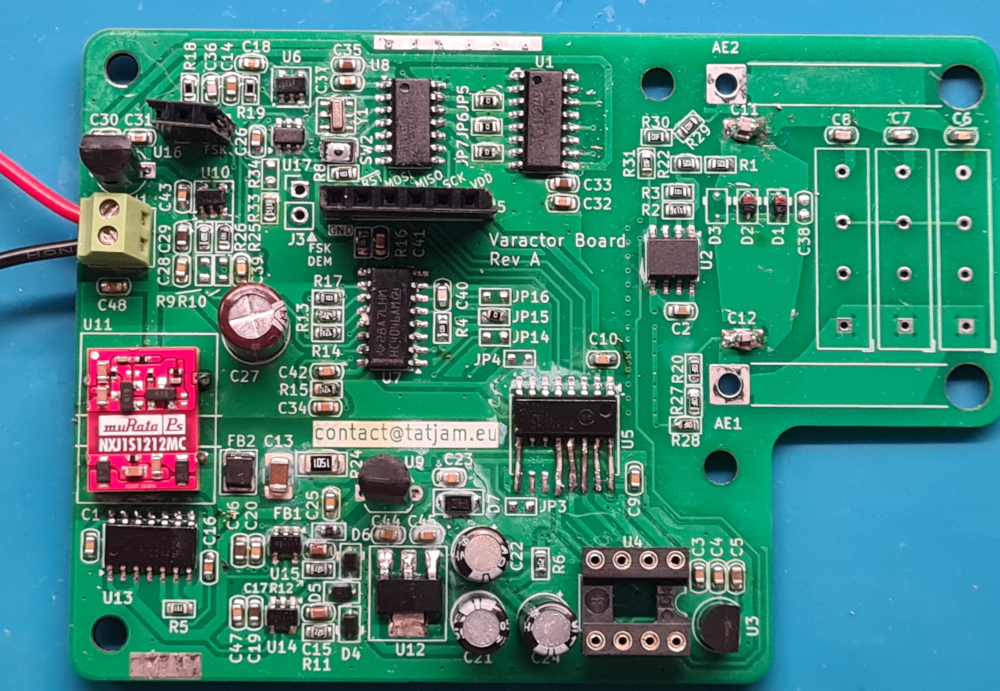

= Electronically tunable capacitor

This repo contains the hardware and firmware for a electronically tunable capacitor designed for RX loop antennas.

Here's how it looks (sorry for the dirty board, I was actively moving jumpers around as this photo was taken!)

